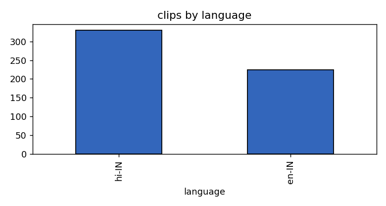
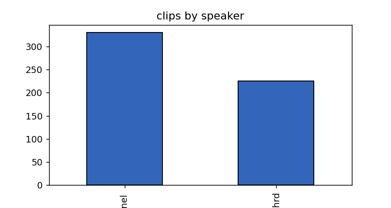
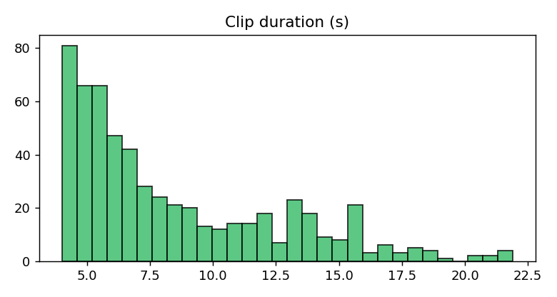
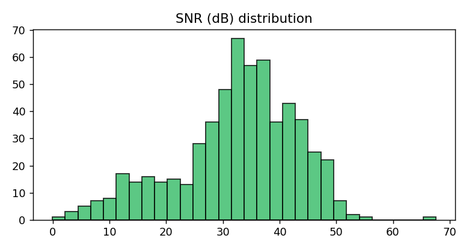
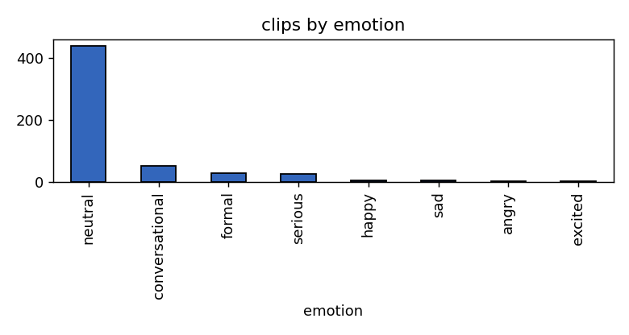

# Indian English + Hindi TTS Dataset

**A 73-minute, licence-verified Indian English and Hindi text-to-speech corpus (555 clips), built by a reproducible
pipeline that quality-gates audio before any paid API call and puts every clip through human review.**

- **Hugging Face:** [`auraCodes/indian-english-hindi-tts-60min`](https://huggingface.co/datasets/auraCodes/indian-english-hindi-tts-60min)
- **Kaggle:** [`kavinthakurkm/indian-english-hindi-tts-dataset`](https://www.kaggle.com/datasets/kavinthakurkm/indian-english-hindi-tts-dataset), with an EDA notebook
- **Report:** [`reports/report.pdf`](reports/report.pdf) · **Design rationale:** [`PLAN.md`](PLAN.md) · **Dataset card:** [`dataset_card.md`](dataset_card.md)

Built for the Sarvam AI ML & Speech Data Pipeline assignment. The work is treated as data curation and quality assurance:
the code makes curation reproducible, auditable and credit-frugal, and the judgment lives in source selection, QC-gate
design and threshold calibration against real data.

## Dataset at a glance

| Property | Value |
|---|---|
| Languages | Indian English (`en-IN`), Hindi (`hi-IN`) |
| Size | 555 clips, 73.2 min (37.7 min English, 35.5 min Hindi) |
| Audio | mono, 24 kHz, 16-bit PCM WAV, loudness-normalised to −23 LUFS, silence-trimmed |
| Clip length | sentence-level utterances, 4.5–18.5 s (median 6.6 s) |
| Signal-to-noise | ≥ 22 dB on every clip (median 43 dB) |
| English source | NPTEL *Psychrometry* lectures (`nptelhrd`), single instructor, CC-BY |
| Hindi source | Bhoopendra Pandey, single-narrator reading of Premchand's essay *"साहित्य का उद्देश्य"*, CC-BY |
| Per-clip fields | `audio`, `text`, `language`, `emotion`, `duration_s`, `speaker`, `source_url`, `license`, `snr_db`, `lufs` |
| Licence | CC-BY-4.0, with per-clip attribution in the manifest |

Figures from [`src/analyze.py`](src/analyze.py):

| Language split | Per speaker |
|:---:|:---:|
|  |  |

| Clip duration | Signal-to-noise ratio |
|:---:|:---:|
|  |  |


*Emotion and style tags, assigned by an LLM from the transcript text. Lecture and narration content is mostly neutral and
formal.*

## Quality results

| Measure | Result | How it was measured |
|---|---|---|
| Funnel | 640 VAD segments → 558 pass acoustic QC (87.2%) → 555 accepted after human review (86.7%) | [`reports/funnel.csv`](reports/funnel.csv) |
| ASR word error rate | 0.05% (en-IN, 225 clips), 0.0% (hi-IN, 330 clips) | Sarvam STT output compared with the human-reviewed transcripts; reviewers edited 1 English clip and no Hindi clips ([`reports/wer.json`](reports/wer.json)) |
| Licence check | 100% of clips carry YouTube's Creative Commons Attribution flag | verified at fetch, recorded per clip in [`data/manifest.csv`](data/manifest.csv) |

## Highlights

| Signal | Where to see it |
|---|---|
| Programmatic licence verification: every source must carry YouTube's *Creative Commons Attribution (reuse allowed)* flag, checked at fetch and recorded per clip | `src/s01_fetch.py`, `data/manifest.csv` |
| Source auditioning: SNR, non-speech gap floor (a continuous-music detector) and speech density profiled before committing to a source | `src/audition.py` |
| Acoustic gate before any paid call: SNR, clipping, loudness and duration filters run before transcription, so rejected audio costs zero credits | `src/s03_acoustic_qc.py` |
| Human-in-the-loop review: accept / reject, reason and transcript edit logged for every clip | `review/review_log.csv` |
| Documented quality iterations: a peak threshold that rejected 94% of clips was diagnosed and fixed (pass rate 3% → 72%), and a Hindi source was replaced after listening review | [`reports/report.pdf`](reports/report.pdf) |
| Reproducible, cached, resumable rebuild: reruns cost zero credits | `Makefile`, `data/cache/` |

## Pipeline

```
sources.yaml → s01 fetch → s02 segment → s03 acoustic QC → s04 transcribe →
(licence gate)  (yt-dlp)    (silero-VAD)   (SNR/clip/loud)   (Sarvam STT, cached)

 s05 verify → s06 review → s07 normalize → s08 emotion → s09 build → HF Hub
 (lang +      (human:        (24 kHz mono,   (LLM tag      (manifest +
  transcript)  listen + fix)  loudnorm,       from text)    push_to_hub)
                              edge-trim)
```

Each stage is an independent, resumable module under `src/`. Every threshold lives in
[`config/pipeline.yaml`](config/pipeline.yaml) with its rationale, so each curation decision is explicit and each
iteration is a reviewable `git diff`.

## Tech stack

| Layer | Used |
|---|---|
| Acquisition | `yt-dlp` with licence metadata checks |
| Audio | silero-VAD (PyTorch), librosa, soundfile, pyloudnorm, SciPy |
| Speech and language | Sarvam STT (speech-to-text) and Sarvam LLM (emotion tags), with retries and a response cache |
| Dataset | Hugging Face `datasets` and Hub, Kaggle |
| Analysis | pandas, jiwer (WER/CER), Matplotlib, WeasyPrint report |
| CI | GitHub Actions: compile check and unit tests on every push |

## Quickstart

```bash
make setup                       # virtualenv + dependencies + .env from template
# edit .env: SARVAM_API_KEY (https://dashboard.sarvam.ai), HF_TOKEN (for publishing)

make all                         # s01..s05: fetch → segment → QC → transcribe → verify
make review                      # s06: interactive listen / accept / reject / correct
make post                        # s07..s09 + analysis + validation
make push                        # publish the Hugging Face dataset
```

Tests: `python -m pytest tests/ -q` (audio and QC core; runs without API keys). Dataset invariants:
`python validate_dataset.py`.

Sources are curated in [`config/sources.yaml`](config/sources.yaml); the fetch-time licence gate is the source of truth,
and any non-CC-BY URL is dropped and logged.

## Repository layout

```
config/      sources.yaml (curated URLs + licence), pipeline.yaml (all thresholds)
src/         s01..s09 stages, audition.py, analyze.py, utils/ (audio, sarvam_client, io)
review/      review_log.csv: per-clip human decisions (the curation record)
data/        manifest.csv (checksums + provenance + QC); raw/segments/clips are gitignored
reports/     report.md / report.pdf, funnel.csv, wer.json, figures/
kaggle/      Kaggle metadata, description and EDA notebook
run_pipeline.py   orchestrator     validate_dataset.py   dataset invariant checks
tests/       unit tests for the audio/QC core
```

## Design choices and roadmap

- **Single-speaker, studio-grade sources.** For a corpus of this size, acoustic consistency matters more than speaker
  variety. A first Hindi source (public discourse) was replaced with clean studio narration after listening review.
- **Sentence-level clips, not fixed cuts.** Voice-activity segmentation gives coherent 4–18 s utterances with clean
  silence boundaries, matching LJSpeech and Hi-Fi TTS conventions; audio is re-cut from the original high-rate source.
- **Gate before you pay.** Acoustic QC runs before transcription and every API response is cached, so iterating on
  thresholds costs no credits.
- **Roadmap:** a blind hand-transcribed WER set, an audio-based emotion classifier, more speakers and a third Indian
  language, and forced alignment for word-level boundaries.

## Licence and ethics

Pipeline code is MIT ([`LICENSE`](LICENSE)). Audio is CC-BY-4.0, sourced only from videos carrying YouTube's Creative
Commons Attribution flag, verified per clip and recorded in the manifest with attribution. TED (CC-BY-ND), All India
Radio (paid licence) and standard-licence news and podcast content were deliberately excluded; see
`config/sources.yaml` and the report's licensing section.
